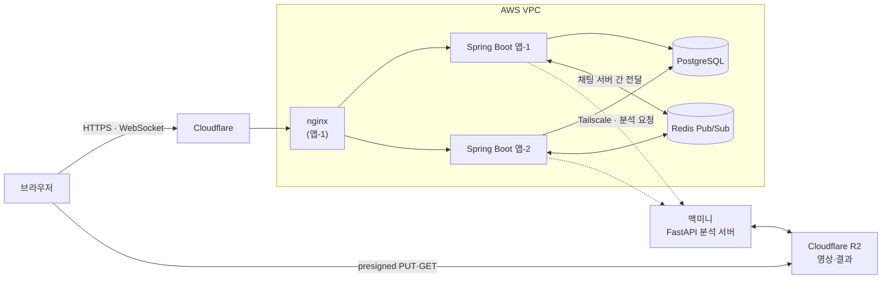
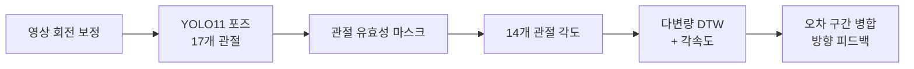

# ODO — 댄스 팀 연습 플랫폼

> 댄스 팀이 공연을 준비하며 연습 과제·일정·공지를 주고받는 **팀 스페이스(미션·채팅)**와,
> 프로 댄서 영상과 내 연습 영상을 비교해 어긋난 구간을 짚어 주는 **춤 분석**을 제공합니다.


| | |
|---|---|
| **기간** | 2025.03–현재 (춤 분석 2025.03~, 팀 채팅 2026.10) |
| **인원** | 개인 |
| **역할** | 기획, 백엔드(채팅 설계·부하 측정·성능 개선, 분석 서비스), 분석 엔진 설계·검증, 배포·운영 |
| **상태** | 배포 및 개선 중 |
| **배포** | [odostudio.site](https://odostudio.site) |

---

## 목차

1. [전체 아키텍처](#전체-아키텍처)
2. [팀 채팅](#팀-채팅) — 기능, 성공 기준, 핵심 설계, 성능 개선
3. [춤 분석](#춤-분석) — 기능, 분석 방식, 비동기 처리, 검증
4. [문서](#문서)
5. [저장소 구성](#저장소-구성)
6. [로컬 실행](#로컬-실행)

---

## 전체 아키텍처



| 경로 | 흐름 | 핵심 |
|---|---|---|
| **채팅** | 브라우저 ⇄ 웹소켓(STOMP) ⇄ 앱 서버 → PostgreSQL 저장 → Redis 방 채널 → 다른 서버의 구독자 | 저장은 DB가 원본, Redis는 전달 통로. 웹소켓은 어느 서버에 붙어도 된다 |
| **춤 분석** | 브라우저 → R2 직접 업로드 → 앱 서버가 분석 요청(202) → 맥미니가 R2에서 받아 분석 → 결과를 R2에 | 영상은 앱 서버를 지나가지 않는다. 분석은 약 2분이라 비동기 + 진행률 폴링 |

- 운영 구성(앱 2대 + DB + Redis, 네트워크·배포·모니터링 원칙)은 [deploy/README.md](deploy/README.md) "운영 구성"에 있습니다

---

## 팀 채팅

팀장이 공지를 올리면 **누가 어디까지 읽었는지** 알아야 팀을 운영할 수 있습니다. 그래서 안 읽은 수와 멤버별 읽음 위치를
핵심 기능으로 정했고, 서버 여러 대에서도 순서·정확성·권한이 지켜지도록 설계한 뒤 부하를 걸어 병목을 차례로 고쳤습니다.

> 설계 대안 비교, 시퀀스, 측정 방법, 단계별 전후 수치 전체 → **[채팅 딥다이브](docs/chat-deep-dive.md)**

### 핵심 기능

- **메시지 전송**: 팀 채팅방과 DM. 서버가 여러 대여도 모든 멤버가 같은 번호·같은 순서로 본다
- **읽음 표시**: 메시지별 안 읽은 사람 수, 멤버별 읽음 위치
- **멤버 추방**: 추방하는 순간부터 그 방의 송수신 차단(다른 서버에 붙은 연결 포함)
- **가용성**: 웹소켓 끊김·저장 실패·전달 유실이 생겨도 메시지가 사라지거나 두 번 저장되지 않고, 재연결하면 놓친 메시지를 채운다

### 성공 기준

| 지표 | 기준 | 뜻 |
|---|---|---|
| 메시지 전달 p95 | 100ms 이하 | 보낸 메시지가 다른 멤버 화면에 도착하기까지 |
| 읽음 반영 p95 | 1초 이하 | 메시지가 화면에 보인 순간부터 다른 멤버의 읽음 표시가 바뀌기까지 |
| 정합성 | 위반 0건 | 측정마다 DB 검사: 번호 빈틈·중복, 읽음 위치 멈춤 |

### 처리량 — 측정 환경 기준

| 단계 | 처리 한계 (초당 메시지) |
|---|---|
| 기준선 | 800~1,200 |
| + 읽음 보고 클라이언트 배칭 | 1,600~2,000 |
| + 처리 스레드 4 → 8 (그룹 커밋) | 2,400~3,000 |
| + 서버 쪽 write-behind 배치 | **3,000~3,600** (초당 3,000건에서 전달 p95 79ms) |

- **측정 환경**: PC 한 대(Ryzen 7 7800X3D)의 컨테이너, 앱 서버 2대(각 CPU 2·메모리 2GB), PostgreSQL CPU 2, 1,000방 × 4명(세션 4,000), 방마다 2명이 화면을 봄. 운영 서버의 처리량이 아닙니다
- 처리 한계 = 성공 기준을 지킨 마지막 단계와 처음 넘긴 단계 사이. 모든 측정에서 정합성 위반 0건

### 핵심 설계

| 문제 | 선택 | 대가 |
|---|---|---|
| 서버 여러 대에서 방 안 번호를 겹치지도 빠지지도 않게 | **DB 채팅방 행 `UPDATE … RETURNING`**으로 번호 증가와 저장을 한 트랜잭션에. 실패하면 번호도 되돌아가 빈틈이 없다 (Redis 카운터·분산락·JVM 락은 버림) | 같은 방은 한 줄로 처리 → 방 하나의 처리량 상한. 잠금 순서를 정해 교착 방지 |
| 한 사람이 연달아 보낸 순서가 섞이거나 재전송으로 두 번 저장 | 세션별 순서 대기열 + **재시도 소진 시 그 연결을 멈추고 재개**, 브라우저가 붙인 ID로 `UNIQUE(sender_id, client_message_id)` → 중복이면 기존 번호로 성공 응답 | 재시도 동안 스레드 점유 → 최악 처리 시간을 약 2분 → 32.5초로 묶음 |
| 다른 서버에 붙은 멤버에게 전달 | **Redis Pub/Sub 채팅방별 채널**, 커밋 뒤에만 발행. 유실은 번호의 빈틈으로 감지해 DB에서 채움(한 경로로 복구) | 그 순간 Redis 유실 가능 → "느려지지만 틀리지 않는" 장애로 설계 |
| 추방된 멤버가 다른 서버·추방 순간에 주고받음 | 쓰기는 방 행 잠금 뒤 DB로 확인, 전달은 허용 방 캐시 + **제어 이벤트(즉시) + 5초 재확인(유실 대비)** | 이벤트가 사라진 드문 경우 받기만 최대 약 5초 |

- 각 설계는 테스트로 확인했습니다(CI, PostgreSQL·Redis 컨테이너): 같은 방 동시 전송 100개의 번호 무결성, 추방·전송 경쟁, 차단·구독 동시 200회 경쟁, 서버 2대 양방향 전달과 Redis 장애 중 저장 지속 등

### 성능 개선 — 병목을 측정으로 찾아 차례로

| | 문제 (측정으로 찾은 원인) | 해결 | 결과 |
|---|---|---|---|
| **1** | 사전 점검 세션 40개에서 전달 0건. OSIV로 읽음 보고 요청이 커넥션을 2개씩 쥐어 풀(10) 고갈 | 재현 테스트(동시 25개)를 먼저 만들고, 스냅샷 조회를 읽기 전용 트랜잭션 안으로 | 요청당 커넥션 2 → 1, 재현 테스트 34.7초 실패 → 4.1초 통과 |
| **2** | 초당 820건부터 전달 p95 약 10초. 읽음 보고(메시지 수 × 보는 사람 수)가 앱 CPU를 차지 | **읽음 보고 클라이언트 배칭(500ms)** | 처리 한계 약 1.7~2배, 앱 CPU −45%, 대가: 읽음 반영 p95 22.9 → 484ms |
| **3** | CPU가 남는데 초당 약 1,990건에서 정체. 1건 처리의 69~77%가 WAL 동기화 대기 | **처리 스레드 4 → 8**로 동시에 기다리는 커밋을 한 번의 동기화에 묶음(그룹 커밋). 동기화를 건너뛰는 커밋은 메시지 유실 위험으로 버림 | 처리 한계 약 1.5배, 초당 2,000건 전달 p95 2,090 → 24ms |
| **4** | 보고마다 DB 갱신 | **서버 쪽 write-behind 배치(500ms)** + 서버별 반영 시점 분산(0·250ms) + 일괄 조회·Redis 파이프라인 | 처리 한계 약 1.2배, 1회 처리 212 → 22ms, 대가: 읽음 반영 p95 877ms |

### 측정을 믿을 수 있게

- **측정기를 먼저 쟀습니다.** 부하 생성기를 직접 만들고(Node.js, 화면과 같은 STOMP 라이브러리, open-loop), 정해진 지연만 넣는 가짜 서버로 측정기 오차와 믿을 수 있는 부하 범위를 먼저 정했습니다
- **판정 규칙을 측정 전에 정했습니다.** 오차 한도 = 기준의 5%, 측정값이 기준에서 보정 오차보다 멀 때만 판정, 개선은 차이가 오차보다 클 때만 주장, 한계 근처는 3회 중앙값
- **측정 도구의 결함 10개를 찾아 고쳤습니다.** 예: 가짜 서버가 느려 측정기 오차가 음수로 보이던 착시, CPU 비율을 코어로 읽은 단위 오독, 누적 카운터 넘침

### 한계

- 모든 성능 수치는 PC 한 대의 측정 환경 값이고, 운영 서버에는 부하 테스트를 하지 않았습니다
- 읽음 표시가 한꺼번에 나가는 순간 근처의 메시지 전달 p95는 최악 조건에서 115ms로 기준을 넘습니다
- 방 크기 4~20명만 확인했습니다. OSIV는 아직 켜져 있습니다

---

## 춤 분석

기준 영상(프로 댄서)과 내 연습 영상을 올리면 **어느 대목에서 어떤 동작이 어긋났는지**를 구간 단위로 짚어 줍니다.
대학에서 처음 춤을 배우고 팀장으로 후배들과 공연을 준비하면서, 제가 없는 시간에도 후배가 스스로 동작을 점검할 방법을 만들고 싶었습니다.

> 모델 선택, 파이프라인, 시스템 구조, 검증, 문제 해결 전체 → **[춤 분석 딥다이브](docs/video-analysis-deep-dive.md)**

### 데모

> **[배포 서비스 열기](https://odostudio.site)** · 소셜 로그인 후 아래 흐름을 직접 확인할 수 있습니다.

1. 기준 영상과 연습 영상을 업로드합니다.
2. 두 영상에서 같은 안무가 시작되는 지점을 지정합니다.
3. 분석 진행률을 확인하고, 완료되면 알림을 받습니다.
4. 정렬된 두 영상과 박자 그래프, 다듬을 구간을 함께 확인합니다.

<!-- TODO: docs/demo.gif 추가 — 업로드 → 구간 지정 → 분석 → 나란히 비교 재생까지 10초 내외 -->

### 기능

- **나란히 비교**: 기준 영상은 원래 속도로 흐르고 내 영상이 늘어나고 줄어들며 따라간다. 내 영상이 빨리 감기면 그 대목에서 내가 느렸던 것이다
- **박자 어긋남 그래프**: 기준 대비 앞섰는지·뒤처졌는지의 누적 차이
- **다듬을 구간 목록**: 시간 순이 기본, 심각도는 배지. 구간을 누르면 그 대목만 0.5배속으로 반복 재생
- **완전 자동 채점이 아니라 반자동**입니다. 정렬 실패가 "불확실한 매칭"이 아니라 "확신에 찬 오답"으로 나타난다는 실측이 근거입니다

### 분석 방식



| 축 | 문제 | 접근 |
|---|---|---|
| 시간 | 같은 안무라도 시작 시점과 속도가 다름 | DTW 정렬 |
| 촬영 조건 | 카메라 거리·각도·체형이 다름 | 좌표 대신 몸통 기준 **관절 각도** |
| 표현 | 프레임별 수치는 사람이 못 읽음 | 구간 병합 + 방향 문구 |

### 비동기 처리

- 분석에 약 2분이 걸려 HTTP 요청을 붙잡고 있을 수 없습니다. 요청은 **202 Accepted**로 바로 응답하고, 브라우저는 진행률을 폴링합니다
- CPU를 오래 쓰는 분석은 **별도 서버(맥미니 FastAPI)**로 분리했습니다. 앱 서버는 인증·권한·작업 상태만 맡고, 맥미니는 공인 IP 없이 Tailscale로만 닿습니다
- 영상은 브라우저가 R2로 직접 올리고 맥미니가 직접 받습니다. 맥미니에는 저장소 키 대신 요청마다 짧은 presigned URL만 줍니다
- 앱 서버가 2대가 된 뒤에도 분석은 PostgreSQL advisory lock으로 전체 동시 1건만 보냅니다

### 검증

기능을 늘리기 전에 **"이게 맞나"를 확인할 방법**부터 만들었습니다. 원본 영상을 알려진 양만큼 변형해(시간 오프셋, 배속, 렌즈 왜곡, 재인코딩) 정답을 아는 데이터를 합성하고 정렬 정확도를 쟀습니다.

| 측정 | 결과 |
|---|---|
| 정렬 정확도 (앵커 ±5프레임) | 71.8% → **78.9%** (구간 지정) → **81.6%** (각속도 보조) |
| 뼈 안정성 (낮을수록 좋음) | yolo11x **0.0127** / yolov8n 0.0143 / MediaPipe Full 0.0189 |
| 프레임 솎기 (stride=2) | 분석 **44% 단축**, 지적 구간 상위 10개 **100% 재현** |

### 한계

- 정렬이 실패했는지 자동으로 알 수 없습니다(신뢰도 신호 5종이 정렬 오차를 예측하지 못함, 상관 0.03~0.26)
- 촘촘한 정렬 정답은 합성 데이터이고, 피드백 문구의 효과는 정성 평가 단계입니다
- 분석 서버가 동시 1건, 건당 약 2분이라 이론상 처리량 상한이 시간당 약 30건입니다

---

## 문서

| 문서 | 내용 |
|---|---|
| [채팅 딥다이브](docs/chat-deep-dive.md) | 요구사항, 구조, 핵심 설계(대안 비교·대가·검증), 측정 방법, 성능 개선 단계별 수치, 운영 반영, 한계 |
| [춤 분석 딥다이브](docs/video-analysis-deep-dive.md) | 분석 설계, 모델 선택, 시스템 구조, 비동기 흐름, 검증, 문제 해결 |
| [분석 엔진 기술 보고서](docs/analysis-engine-report.md) | 분석 방법론의 문제 정의, 검증 체계, 기술 선택 실험, 결과 종합 |
| [엔지니어링 노트](docs/engineering-notes.md) | 분석 서비스 구현·배포에서 겪은 것들, 회고 |
| [부하 측정 도구](load-test/README.md) · [측정 결과](load-test/results/) | 채팅 부하 생성기·가짜 서버·시드, 날짜별 측정 기록 |
| [배포·운영](deploy/README.md) | 서버 준비, 운영 구성, 운영 점검 방법 |

---

## 저장소 구성

| 경로 | 내용 |
|---|---|
| `web-service/api-server/` | Spring Boot — 인증·권한, 팀·미션, 채팅(STOMP·Redis), 분석 작업 조율 |
| `web-service/frontend/` | React 19 + Vite |
| `ai-server/` | FastAPI 분석 서버 — 분석 전용, 아무것도 보관하지 않음 |
| `model-research/` | 분석 방법론 실험·검증 코드 |
| `load-test/` | 채팅 부하 생성기, 측정기 보정용 가짜 서버, 시드, 측정 결과 |
| `deploy/` | nginx·systemd 설정, 배포 스크립트, 측정 환경(`loadtest/`), 운영 모니터링(`monitoring/`) |
| `docs/` | 딥다이브와 기술 보고서 |

---

## 로컬 실행

<details>
<summary><b>환경별 실행 방법 보기</b></summary>


### 요구 사항

- **`model-research`: Python 3.10 고정** — 비교 대상이었던 MediaPipe(0.10.x)가
  3.11 이상에서 `mp.solutions` API를 제공하지 않습니다. 비교 실험을 재현하려면 필요합니다
- **`ai-server`: Python 3.10~3.13** — torch 휠이 cp310~cp313입니다.
  서비스는 MediaPipe를 쓰지 않으므로 3.10에 묶이지 않습니다
- Java 17 (Spring Boot), Docker (로컬 PostgreSQL·Redis)
- Node.js (React 19 + Vite)

### 연구·검증 모듈 (`model-research`)

```bash
cd model-research
python3.10 -m venv venv          # 시스템 기본 python이 3.13이면 그냥 python으로는 안 됨
source venv/bin/activate
pip install -r requirements.txt

# 분석 실행 — 반드시 프로젝트 루트에서 -m 으로 (경로 직접 실행 시 import 깨짐)
python -m src.main --pose-backend yolo --feature angle

# 검증 데이터 생성 및 측정
python -m tools.make_variants --video data/videos/real/user_dancer.mp4
python -m tools.eval_alignment --mode variant --gt data/variants/user_dancer__local0.50.gt.json
python -m tools.eval_pose_quality --video data/videos/real/user_dancer.mp4 \
    --models yolo:models/yolov8n-pose.pt yolo:models/yolo11x-pose.pt
```

모델 가중치(`models/*.pt`)는 최초 실행 시 자동 다운로드됩니다.

### AI 서버 (`ai-server`)

```bash
cd ai-server
python3 -m venv venv && source venv/bin/activate
pip install -r requirements.txt

# 127.0.0.1에만 바인딩합니다. 이 서버에는 인증이 없고,
# 접근 통제를 "네트워크에서 닿을 수 없다"에 의존합니다.
uvicorn main:app --host 127.0.0.1 --port 8000
```

### API 서버 · 프론트엔드

채팅은 PostgreSQL과 Redis가 필요합니다. 로컬에서는 컨테이너로 띄웁니다.

```bash
docker compose -f deploy/local/compose.yml up -d postgres redis
cd web-service/api-server && ./gradlew bootRun    # dev 프로파일이 기본
cd web-service/frontend  && npm install && npm run dev
```

개발 환경에서는 **R2 자격증명 없이도** 전 과정이 돌아갑니다
(`storage.type=local`, 로컬 디스크가 presigned URL을 흉내냅니다).
소셜 로그인 없이 확인할 수 있는 개발용 로그인 경로는 `dev` 프로파일에만 존재하며,
운영 프로파일에서는 비활성화됩니다. 개발 계정 정보는 공개 문서에 고정하지 않습니다.

</details>
