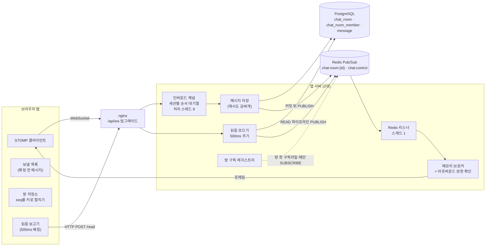
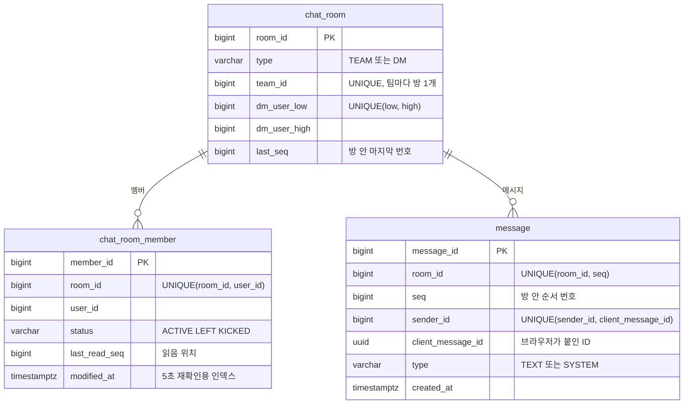
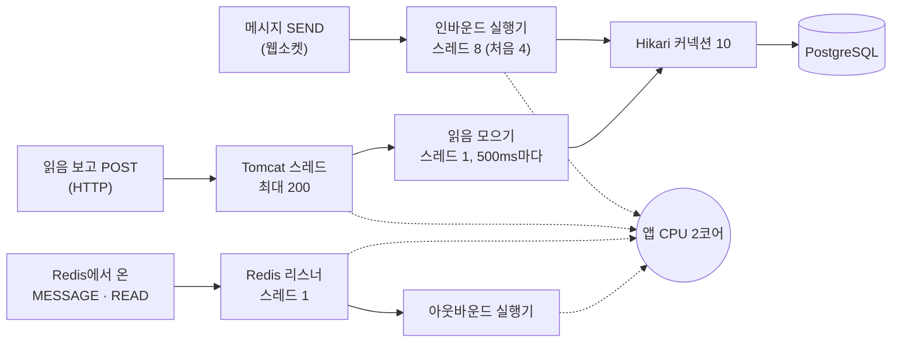
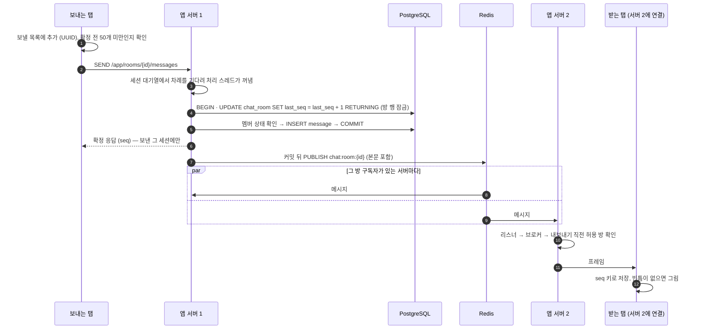
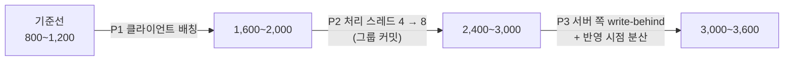

# 팀 채팅 — 설계와 성능 딥다이브

> 팀 채팅(팀 채팅방, DM, 안 읽은 수, 멤버별 읽음 위치)을 **서버 여러 대에서** 돌리기 위해 설계하고,
> 부하를 걸어 병목을 차례로 찾고 고친 기록입니다. README의 채팅 요약은 이 문서를 줄인 것입니다.
>
> - 성능 수치는 모두 [측정 환경](#41-측정-환경)(PC 한 대의 컨테이너, 앱 서버 2대)에서 잰 값입니다. 운영 서버의 처리량이 아닙니다
> - 날짜별 원본 기록은 [`load-test/results/`](../load-test/results/), 측정 도구는 [`load-test/`](../load-test/README.md), 운영 구성은 [`deploy/README.md`](../deploy/README.md) "운영 구성"에 있습니다

---

## 목차

1. [요구사항 — 무엇을 지켜야 했나](#1-요구사항--무엇을-지켜야-했나)
2. [전체 구조](#2-전체-구조)
3. [핵심 설계](#3-핵심-설계)
   - 3.1 [방 안의 순서 번호](#31-방-안의-순서-번호)
   - 3.2 [한 사람의 순서, 중복, 흐름 제어](#32-한-사람의-순서-중복-흐름-제어)
   - 3.3 [서버 사이 전달과 누락 복구](#33-서버-사이-전달과-누락-복구)
   - 3.4 [권한과 멤버 변화](#34-권한과-멤버-변화)
   - 3.5 [읽음 표시](#35-읽음-표시)
4. [측정 방법 — 숫자를 믿을 수 있게](#4-측정-방법--숫자를-믿을-수-있게)
5. [성능 개선 — 병목을 차례로](#5-성능-개선--병목을-차례로)
6. [운영 반영](#6-운영-반영)
7. [한계와 다음 단계](#7-한계와-다음-단계)
8. [기록 색인과 용어](#8-기록-색인과-용어)

---

## 1. 요구사항 — 무엇을 지켜야 했나

### 1.1 왜 읽음 표시가 핵심인가

- 팀 스페이스에서 미션(연습 과제)·일정·공지를 주고받는 소통 수단으로 채팅을 넣었다
- 팀장이 팀을 관리하려면 **팀원이 공지를 확인했는지** 알아야 한다 → 안 읽은 수와 멤버별 읽음 위치를 핵심 기능으로 정했다
- 이 결정의 비용: 화면을 보는 사람마다 "여기까지 읽었다"는 보고가 생겨, **보고 수 = 메시지 수 × 보는 사람 수**가 된다. 성능 문제의 출발점이 여기다([5.2](#52-읽음-보고-클라이언트-배칭))
- 방 크기는 팀 단위 4~20명이다. 수천 명 방(오픈 채팅)은 범위 밖이다

### 1.2 지켜야 할 것

| 목표 | 뜻 | 어디서 지키나 |
|---|---|---|
| 순서 | 서버가 여러 대여도 모든 멤버가 같은 순서로 본다 | [3.1](#31-방-안의-순서-번호) |
| 정확성 | 보낸 메시지는 사라지거나 두 번 저장되지 않는다 | [3.2](#32-한-사람의-순서-중복-흐름-제어), [3.3](#33-서버-사이-전달과-누락-복구) |
| 우선순위 | 과부하에서도 메시지가 읽음 처리보다 먼저다 | [5장](#5-성능-개선--병목을-차례로) |
| 권한 | 추방된 멤버는 그 순간부터 그 방을 보내지도 받지도 못한다 | [3.4](#34-권한과-멤버-변화) |

### 1.3 성공 기준

| 지표 | 기준 | 재는 구간 |
|---|---|---|
| 메시지 전달 p95 | 100ms 이하 | 보낸 탭이 SEND 직전에 찍은 시각 → 다른 탭이 프레임을 받은 순간 |
| 읽음 반영 p95 | 1초 이하 | 메시지가 **화면에 이어 붙은 순간** → 다른 탭의 읽음 표시가 바뀐 순간 |
| 정합성 | 위반 0건 | 측정이 끝날 때마다 DB 검사([`invariants.sql`](../load-test/seed/invariants.sql)): 방별 번호 빈틈·중복, 읽음 위치 > 마지막 번호, 읽음 위치 멈춤 |

- 읽음 반영의 시작점을 "보고를 보낸 순간"이 아니라 "화면에 보인 순간"으로 잡았다. 브라우저가 보고를 모아 보내면([5.2](#52-읽음-보고-클라이언트-배칭)) 그 대기가 지연에 포함돼야 대가를 숨기지 않는다

---

## 2. 전체 구조

### 2.1 구성 요소



- 웹소켓 연결과 구독은 서버 한 대의 메모리에만 있다. 서버 사이는 **Redis 방 채널**이 잇는다
- 저장은 PostgreSQL이 원본이다. Redis는 전달 통로일 뿐 저장하지 않는다(유실 허용, [3.3](#33-서버-사이-전달과-누락-복구))
- 인증은 웹소켓 핸드셰이크의 httpOnly 쿠키(JWT)로 한 번 한다. 핸드셰이크에서 `Origin`을 허용 목록과 대조한다. 웹소켓에는 브라우저의 CORS가 적용되지 않아 교차 사이트 웹소켓 탈취는 서버가 막아야 한다

### 2.2 데이터 모델



| 제약 | 막는 것 |
|---|---|
| `UNIQUE(room_id, seq)` | 번호 중복. 정상 경로에서는 걸리지 않는 **안전망**이다. 설계가 틀리면 조용히 틀어지지 않고 저장 순간 오류로 드러난다. "방 X의 seq 이후/이전" 조회 인덱스를 겸한다 |
| `UNIQUE(sender_id, client_message_id)` | 같은 메시지 두 번 저장(멱등성). 보낸 사람을 키에 넣어 남의 UUID로 남의 번호를 돌려받지 못하게 한다 |
| `UNIQUE(dm_user_low, dm_user_high)` | 두 사람 사이 DM이 2개 생기는 경우. 팀 방은 CHECK로 두 칸이 항상 NULL이고 PostgreSQL은 NULL끼리 같다고 보지 않아, 부분 인덱스 없이 일반 UNIQUE로 충분하다 |
| `UNIQUE(client_message_id) WHERE type = 'SYSTEM'` | 시스템 메시지(입장·퇴장·추방 안내) 중복. 보낸 사람이 NULL이라 위 UNIQUE로는 막히지 않는다 |
| `CHECK(last_seq >= 0)`, 내용 2,000자 | 입력 오류를 DB에서도 거절 |

- 마지막 메시지 미리보기 칸을 두지 않았다. `last_seq`로 메시지를 바로 찾을 수 있어(`UNIQUE(room_id, seq)`), 같은 값을 두 곳에 두고 맞추는 일을 만들지 않았다
- 안 읽은 수는 저장하지 않고 `last_seq − last_read_seq`로 계산한다

### 2.3 스레드와 풀 지도

자원이 모자랄 때 누가 먼저 밀리는지는 "어떤 일이 어떤 스레드와 풀을 지나는가"로 정해진다. 성능 분석은 모두 이 지도에서 출발했다.



- 점선은 "CPU를 나눠 쓴다"는 뜻이다. CPU가 모자라면 일하고 싶은 스레드들이 CPU 시간을 나눠 갖고, **스레드 수가 많은 쪽이 더 많이 가져간다** → 처음 병목의 원인([5.2](#52-읽음-보고-클라이언트-배칭))
- 메시지 저장과 읽음 처리는 같은 커넥션 10개를 쓴다 → 읽음 쪽 결함이 메시지까지 세운 원인([5.1](#51-osiv-커넥션-이중-점유))
- Redis 리스너는 DB를 쓰지 않는다. 발행 데이터에 본문과 읽음 위치가 실려 온다

### 2.4 메시지 한 건의 흐름



- 발행한 서버도 Redis에서 다시 받아 전달한다. 직접 보내기와 Redis 경로를 섞지 않아 **전달 경로가 하나**다

---

## 3. 핵심 설계

각 항목은 같은 순서로 적었습니다: **문제 → 대안 비교 → 선택과 구현 → 대가 → 검증**.

### 3.1 방 안의 순서 번호

**문제**

- 같은 방에 메시지가 동시에 들어올 때, 서버가 2대 이상이면 누가 번호를 매기는가
- 번호가 지켜야 할 조건 네 가지: 방 안에서 겹치지 않는다, 같은 메시지는 다시 와도 번호가 하나다, 번호 순서가 화면 순서다, **빈틈이 없다**
- 이 번호가 누락 감지([3.3](#33-서버-사이-전달과-누락-복구))와 안 읽은 수 계산의 바탕이다

**대안** — 모두 "한 방의 번호 매기기를 어디에서 한 줄로 세우느냐"의 차이였다. 모든 서버가 함께 보는 곳이어야 한다.

| 대안 | 판단 |
|---|---|
| 서버 메모리 락(JVM 락) | 버림: 다른 서버를 못 막는다. 1대여도 커밋 전에 락이 풀려 같은 번호가 가능하다 |
| Redis 원자 카운터(INCR) | 버림: 저장이 실패해도 번호가 되돌아가지 않아 빈틈이 생긴다 |
| Redis 분산락 + DB 저장 | 버림: 지킬 대상이 이미 DB 행이라 네트워크 왕복만 늘고, Redis 장애 시 전송이 멈춘다 |
| 메시지 큐 + 단일 소비자 | 버림: 소비자가 모든 방의 단일 장애점이 된다 |
| **DB 채팅방 행 UPDATE** | **채택**: 번호 증가와 저장이 한 트랜잭션이라 실패하면 함께 취소되고, 번호 순서 = 커밋 순서다 |

**선택과 구현**

```sql
BEGIN;
UPDATE chat_room SET last_seq = last_seq + 1, modified_at = clock_timestamp()
 WHERE room_id = :roomId RETURNING last_seq, modified_at;          -- ① 방 행 잠금 + 번호 + 시각
SELECT status FROM chat_room_member WHERE room_id = :roomId AND user_id = :me;  -- ② 잠금 "뒤에" 멤버 확인
INSERT INTO message (room_id, seq, sender_id, type, content, client_message_id, created_at) ...;  -- ③
COMMIT;
```

- ①의 한 문장이 읽기·증가·쓰기를 한 번에 해서 끼어들 틈이 없다. 같은 방의 다음 트랜잭션은 ①에서 앞 트랜잭션의 커밋·롤백까지 기다린다. 롤백하면 번호도 되돌아가 빈틈이 없다. 다른 방은 다른 행이라 병렬이다
- ②를 ① 뒤에 두는 이유: 추방도 방 행을 먼저 잠가([3.4](#34-권한과-멤버-변화)) 둘이 같은 줄에 선다. READ COMMITTED에서 잠금을 얻은 뒤의 조회는 추방 결과를 반드시 본다
- 시각을 ①에서 받는 이유: `now()`는 트랜잭션 시작 시각이라 잠금을 기다리는 동안 번호와 시각이 뒤집힐 수 있다. 잠금을 쥔 채 `clock_timestamp()`를 찍으면 번호가 크면 시각도 같거나 늦다
- 트랜잭션 안에는 번호와 저장만 넣고, Redis 발행과 확정 응답은 커밋 뒤로 뺐다 → 잠금 보유 시간이 짧다
- 잠금 단위가 방이라 DB를 나눌 때 방 ID를 샤드 키로 그대로 쓸 수 있다

**대가**

- 같은 방은 한 줄로 처리돼 **방 하나의 처리량에 상한**이 있다(팀 단위 방이라 받아들였다)
- 잠금을 기다리는 동안에도 커넥션을 쥔다
- 잠금 순서가 엇갈리면 교착이 생긴다 → 모든 경로의 잠금 순서를 정했다([3.4](#34-권한과-멤버-변화))

**검증**

- 부하 측정 전체 메시지 562,575건에서 번호 빈틈·중복·범위 초과 0건(실행마다 정합성 검사). 이후 모든 측정 실행에서도 0건
- 걱정했던 잠금 대기는 문제가 아니었다: 앱 CPU가 포화된 구간에서도 방 행 잠금 대기는 순간 2~3건, 최대 0.02초였다
- 테스트(CI): 같은 방에 100개를 동시에 보내도 번호가 1..N으로 빈틈·중복 없음. 동시 전송 중에 참여·나가기·재가입·추방을 섞어도 교착으로 인한 재시도 0건

### 3.2 한 사람의 순서, 중복, 흐름 제어

**문제**

- 방 행 잠금은 모두가 같은 순서를 보게 하지만, **잠금을 먼저 잡은 메시지가 먼저 번호를 받는다**
- "안녕 → 내일 → 축구하자"를 서버 스레드가 섞어 처리하면 뒤섞인 순서가 모두에게 고정된다
- 끊겼다 다시 연결한 새 연결의 메시지가 옛 연결의 메시지보다 먼저 저장될 수도 있다
- 확정을 못 받은 브라우저는 다시 보낸다 → 같은 메시지가 두 번 올 수 있다

**대안**

| 대안 | 판단 |
|---|---|
| 한 개씩 확정받고 다음 전송 | 보류: 단순하지만 메시지마다 왕복을 기다린다 |
| Redis 번호표 | 버림: 도착 순서만 알고 보낸 순서는 모른다 |
| 직접 만든 대기열 + 예약 재시도 | 보류: 동시성 코드를 직접 짜고 검증해야 한다 |
| **Spring 세션별 순서 대기열 + 실패 시 멈춤·재개** | **채택**: 검증된 대기열을 쓰고, 대가는 재시도 동안 스레드 점유 |

- Spring 대기열(`setPreserveReceiveOrder`)의 소스를 확인해 보니 **앞 메시지가 실패해도 다음 메시지가 출발**했다 → "실패하면 멈춤"은 직접 구현해야 했다

**선택과 구현**

순서 규칙을 먼저 정하고 모든 처리를 거기에 맞췄다: **메시지 k는 k−1이 저장됐거나 영원히 거절된 뒤에만 처리된다.**

| 실패 종류 | 예 | 처리 |
|---|---|---|
| 다시 해 볼 실패 | 연결 실패, 시간 초과, 교착(`40P01`), 직렬화 실패(`40001`) | 최대 4회(100 → 200 → 400ms). 첫 시도 후 3초가 지나면 새 시도를 하지 않는다. 그동안 같은 세션의 다음 메시지는 기다린다 |
| 다시 해도 소용없는 실패 | 멤버 아님, 입력 오류 | 그 메시지만 오류 응답, **멈추지 않고** 다음으로 |
| 실패처럼 보이는 성공 | `client_message_id` 중복 | 롤백(올린 번호도 되돌아감) → 기존 메시지 조회 → **기존 번호로 성공 응답** |
| 재시도 소진 | 4회 모두 실패 | 그 연결을 **멈추고**(`halted`) 실패 응답 1건. 이후 들어온 메시지는 응답 없이 버린다 |
| 원인 모를 예외 | 분류되지 않은 예외 | 처음엔 멈춤. 재개 뒤 같은 메시지가 또 실패하면 영구 실패로 그 메시지만 거절(결정적인 버그가 탭의 전송 전체를 막지 않게) |

- 재시도는 `@Transactional` 메서드 바깥에서 감싼다. 매 시도가 새 트랜잭션이어야 하고, 내부 호출은 프록시를 거치지 않아 새 트랜잭션이 생기지 않는다
- **멈춤 표시를 응답보다 먼저 세운다.** 응답 전송이 예외를 던지면(이미 끊긴 세션) 멈춤 코드가 실행되지 않은 채 다음 메시지가 나가기 때문이다
- 브라우저: 확정 응답을 받은 메시지만 보낼 목록에서 지운다 → 버려진 메시지는 목록에 남는다. 실패 응답을 받으면 2초 뒤 목록 전체를 처음부터, 첫 메시지에 `resume: true`를 붙여 다시 보낸다. 재연결 때는 목록 전체를 원래 순서대로, 같은 UUID로, 새 메시지보다 먼저 보낸다
- 연결이 끊기면 `closed`를 세운다. `halted`와 따로 두는 이유: 대기열에 남은 `resume: true`가 `halted`를 풀어 버릴 수 있기 때문이다
- **흐름 제어는 브라우저가 한다**: 확정 전 메시지가 50개면 더 보내지 않는다(전송 창). 서버의 세션 대기열 상한은 2배인 100이다 — 재개 순간 버려질 옛 사본(최대 49)과 새 사본(50)이 잠깐 겹치기 때문이다. 100을 넘으면 규칙을 어긴 클라이언트로 보고 연결을 끊는다
- "대기열이 차면 그 메시지만 거절"하는 처리는 일부러 뺐다. 거절된 메시지가 나중에 다시 오는 사이 뒤 메시지가 먼저 저장돼 순서가 깨진다

**최악 처리 시간을 다시 계산했다**

- 한 메시지가 처리 스레드를 붙잡는 최악 시간 = 시도 수 × (커넥션 획득 대기 + 쿼리 시간) + 재시도 대기. 처음 값으로는 **약 2분**이었다(시도마다 커넥션 대기 30초)
- 처리 스레드가 모두 묶이면 하트비트도 같은 대기열이라 밀리고, 메모리 브로커의 무신호 판정으로 **정상 사용자까지 한꺼번에 끊긴다** → 재연결이 몰린다
- 트랜잭션 제한 2초 + 재시도 마감 3초로 줄여 **약 32.5초**가 됐다. 남은 커넥션 대기 30초는 채팅 전용 커넥션 풀 같은 대안과 함께 측정 뒤 정하기로 남겼다

**검증(CI)**

- 한 연결에서 연달아 보낸 30개의 확정·저장 순서가 보낸 순서와 같다. 오류를 일부러 넣어 재시도를 소진시켜도 멈춤 → 재개 뒤 저장 순서가 유지된다
- 같은 ID를 동시에 2번 보내도(10번 반복) 행은 1개, 두 응답의 번호는 같다
- 101개를 확정 없이 밀어 넣는 클라이언트는 오류 후 연결이 끊기고, 이미 저장된 메시지의 순서는 유지된다
- 다른 서버로 다시 연결했을 때의 순서·중복은 따로 테스트하지 않았다. 설계상 같은 UUID와 DB 유일 제약 경로를 탄다

### 3.3 서버 사이 전달과 누락 복구

**문제**

- 웹소켓 연결과 구독 목록은 서버 한 대의 메모리에만 있다 → 서버 1에 저장된 메시지는 서버 1 접속자에게만 간다
- 서버가 늘어도 모두에게 실시간으로 가야 하고, 전달 통로에 장애가 나도 유실·순서 오류는 없어야 한다

**대안** — 기준: 모든 서버가 함께 보는 곳일 것, 메시지 저장을 느리게 하지 않을 것, 이 규모에 맞는 운영 비용일 것.

| 대안 | 판단 |
|---|---|
| PostgreSQL LISTEN/NOTIFY | 버림: NOTIFY를 보낸 트랜잭션은 커밋 때 DB 전체 잠금을 잡는다 → 방마다 병렬이던 저장이 한 줄로 선다 |
| Kafka, RabbitMQ | 보류: 유실에 강하지만 원본은 이미 DB에 있고, 인프라가 가장 무겁다 |
| 사용자별 라우팅(접속 서버를 저장해 찾아감) | 버림: 접속 위치 저장·만료·교정 계층과 그 정합성 문제가 새로 생긴다 |
| **Redis Pub/Sub + 채팅방별 채널** | **채택**: 인프라가 가장 가볍고, 그 방 구독자가 있는 서버만 받는다. 대가는 저장하지 않아 그 순간 유실 가능 |

- **유실을 받아들인 근거**: 원본은 DB에 있고 번호에 빈틈이 없어([3.1](#31-방-안의-순서-번호)) 화면이 빠진 것을 스스로 알아챈다. Redis가 멈춰도 저장과 확정 응답은 계속되는 "느려지지만 틀리지 않는" 장애가 된다
- 공개된 대형 메신저 사례 중에는 사용자별 라우팅 계열이 많다. 사용자당 방 수, 1:1 비중, 미접속자 푸시, 서버 수라는 조건이 달라 이 규모에서는 결론이 달라진다고 판단했다

**선택과 구현**

- **커밋 뒤에만 발행한다**(`@TransactionalEventListener(AFTER_COMMIT)`) → 롤백된 메시지는 구조적으로 방송되지 않는다. 발행 데이터에 본문을 실어 받는 서버가 DB를 다시 읽지 않는다
- **방 구독 레지스트리**: 서버는 자기에게 그 방 구독자가 있을 때만 Redis 방 채널을 구독한다. "구독자 집합 변경 + Redis 구독/해제 결정"을 방 단위로 한 번에 처리한다
  - 이걸 원자적으로 하지 않으면, 마지막 구독자가 나가는 순간과 새 구독자가 들어오는 순간이 겹칠 때 "집합엔 있는데 Redis 구독은 끊긴" 상태가 생긴다. 연결은 살아 있고 다음 메시지도 오지 않아 **재연결 복구로도 안 잡히는** 버그다
  - Spring 브로커의 구독표로 대신하지 않았다. 갱신 시점을 통제할 수 없고 이 잠금 안에 넣을 수 없다
- **브라우저 합치기 규칙**: HTTP 응답과 소켓 프레임을 같은 저장소에 들어오는 두 출처로 보고, seq를 키로 넣는다. 화면은 "도착 순서대로 붙이는 목록"이 아니라 "저장소를 정렬해 그린 결과"다. 규칙이 도착 순서와 무관해 무엇이 먼저 와도 결과가 같다
- **누락 복구는 한 경로다**: 원인이 재연결이든 Redis 유실이든 서버 간 발행 순서 뒤바뀜이든, "마지막으로 받은 번호 이후를 DB에서 조회"한다. 42 다음 44가 오면 1초 기다렸다가 43이 안 오면 조회한다(빈틈마다 바로 조회하면 부하가 높을 때 브라우저들이 동시에 DB를 두드린다)
- **구독 먼저, 조회는 나중**: 반대 순서면 조회와 구독 사이의 메시지가 빠지고, 그 뒤 메시지가 없으면 빈틈으로도 보이지 않는다
- **SYNC 장벽**: 메모리 브로커는 SUBSCRIBE에 확인을 주지 않는다. 구독을 보낸 뒤 `SEND /app/sync`를 보내고, 세션 메시지는 차례대로 처리되므로 SYNC 응답이 오면 앞의 구독이 모두 등록됐다고 믿을 수 있다

**대가**

- 서버 간 전달 리스너가 서버마다 스레드 1개라, 받은 일이 몰리면 그 줄에서 기다린다(메시지와 읽음이 같은 줄)
- 끊긴 동안 온 메시지를 재연결 뒤 DB에서 채우는 화면 쪽 복구는 자동 테스트가 없다(부하 측정의 정합성 검사로만 확인)

**검증**

- 리스너 대기 p99: 20명 방 시나리오에서 6.3ms 이하, 서버가 포화된 구간에서도 22~26ms로 병목이 아니었다
- 테스트(CI, 서버 2대): 다른 서버에 붙은 사람에게 양방향으로 실시간 전달. Redis가 응답하지 않는 동안에도 저장과 확정 응답은 계속됐고, 돌아오자 다음 메시지부터 다시 전달되며 받는 쪽은 번호로 빈틈을 알았다. 8개 스레드가 같은 방에 입장·퇴장을 30번 동시에 반복해도 구독 상태가 어긋나지 않았다
- 바꿀 시점을 지표로 정해 두었다: 서버당 구독 채널 수, 접속 1건당 구독 수, 배포 직후 누락 조회 수

### 3.4 권한과 멤버 변화

**문제**

- 추방된 사람이 다른 서버에 붙어 있어도, 추방 순간부터 그 방 메시지를 보내지도 받지도 못해야 한다
- 권한을 매번 DB에서 확인하면 정확하지만 수신자마다 확인해 느리고, 연결 때 읽어 둔 캐시는 빠르지만 낡을 수 있다

**원칙: 쓰기는 원본(DB)으로 엄격하게, 전달은 캐시로 빠르게, 캐시는 이벤트로 갱신한다.** 위험을 "캐시가 갱신되기 전의 수신" 하나로 좁혔다.

| 확인 지점 | 무엇을 | 무엇으로 |
|---|---|---|
| 핸드셰이크 | 쿠키 JWT 유효 + Origin 허용 목록 | 연결당 1번 |
| SUBSCRIBE | 목적지가 `/topic/rooms.{id}`이고 그 방이 허용 방 캐시에 있음. 캐시에 없으면 DB로 한 번 더(방금 만든 DM처럼 권한 이벤트보다 구독이 먼저 온 경우) | 메모리, 없으면 DB |
| SEND | 저장 트랜잭션 안에서 방 행 잠금 뒤 멤버 상태 | DB |
| 서버 → 브라우저 전달 직전 | 나가는 방 프레임의 방이 그 세션 허용 방 캐시에 **아직** 있는지 | 메모리 |
| HTTP 기록·목록 조회 | JWT + DB 멤버십 | DB |

**네 가지 빈틈과 해결**

| 빈틈 | 해결 |
|---|---|
| 권한 확인과 저장 사이에 추방이 끼어든다 | 저장은 방 행 잠금 뒤 멤버를 확인하고, 추방도 상태를 바꾸기 전에 방 행을 잠근다 → 같은 줄에 서서 잠금 뒤 조회가 추방 결과를 반드시 본다. 추방이 커밋된 순간부터 **보내기는 즉시 거부**된다 |
| 다른 서버에 붙은 연결의 캐시를 고쳐야 한다 | 커밋 뒤 모든 서버가 듣는 제어 채널(`chat:control`)에 `REVOKED` 발행 → 받은 서버는 허용 방 캐시에서 **먼저** 지우고(이 순간부터 전달 직전 확인이 막는다) 구독을 정리한 뒤 그 세션에 알린다. 웹소켓은 끊지 않고 그 방만 끊는다 |
| 이벤트가 사라질 수 있다(Redis Pub/Sub) | 서버마다 5초마다 최근 바뀐 멤버십을 **30초 겹쳐** 읽는다(`modified_at`은 문장 실행 시각이라 커밋이 늦게 보이는 경우 대비). 같은 변경을 두 번 적용해도 결과가 같다. 서버 2대 기준 초당 0.4쿼리 |
| 추방 처리와 같은 방 구독 요청이 엇갈린다 | 차단과 구독을 연결 객체 잠금 아래에서 차례로 처리 → 차단된 방의 구독이 남지 않는다 |

| 대안(다른 서버 캐시 갱신) | 판단 |
|---|---|
| 브라우저에 구독 해제만 지시 | 버림: 악의적인 클라이언트가 무시할 수 있다 |
| 아웃박스(발행 내용을 DB에 함께 기록) | 버림: 받는 서버가 그 순간 Redis와 끊긴 경우는 못 막는다 |
| **즉시 제어 이벤트 + 5초 재확인** | **채택**: 평소엔 이벤트로 ms 단위, 이벤트가 사라져도 재확인이 보완 |

- **잠금 순서**: 모든 경로가 `team_member → chat_room → chat_room_member → message` 순서로 잠근다. 메시지 저장은 채팅방 행만 잠그고 멤버 행은 읽기만 하므로 순환이 생기지 않는다
- **DM 동시 개설**: 두 사람을 (작은 ID, 큰 ID)로 저장하고 `INSERT … ON CONFLICT DO NOTHING` → 기존 방 조회. 동시에 서로 걸어도 같은 방 하나를 받는다
- **팀 변화와 채팅 멤버**: 팀 참여·재가입·나가기·추방은 팀 트랜잭션 안에서 채팅 멤버 상태를 함께 바꾼다. 시스템 메시지는 커밋 뒤 새 트랜잭션으로 남긴다(실패해도 팀 처리는 그대로)

**대가**

- 이벤트가 사라진 드문 경우, 보내기는 즉시 막히지만 **받기는 재확인이 돌 때까지 최대 약 5초** 이어질 수 있다

**검증(CI, PostgreSQL·Redis 컨테이너 통합 테스트)**

- 추방과 전송을 경쟁시켜도(5번 반복) 추방 커밋 이후 번호를 가진 그 사람의 메시지는 0건
- 서버 1에서 추방하면 서버 2에 붙은 그 사람은 그 방만 끊기고 웹소켓과 다른 방은 유지. 추방 이벤트를 일부러 잃어도 약 5초 안에 차단
- 두 사람이 동시에 서로 DM을 열어도(10쌍) 방은 하나
- 차단과 구독을 동시에 200번 경쟁시켜도 차단된 방의 구독이 남지 않았다. 연결 객체 잠금 조건을 빼면 이 테스트가 실패하는 것도 확인했다
- "재확인이 이벤트보다 먼저 찾은 변경 수"를 지표로 남겨 이벤트 유실을 상시 감시한다

### 3.5 읽음 표시

- 읽음 위치는 **"더 큰 값일 때만 갱신"**한다. 같은 사용자의 다른 탭이 먼저 올렸거나 작은 값이 늦게 도착해도 위치가 뒤로 가지 않는다
- 위치가 바뀌면 방 멤버 전원의 위치 스냅샷과 버전(DB의 `statement_timestamp`)을 `READ` 프레임으로 보낸다. 받는 쪽은 메시지 번호별로 "아직 읽지 않은 사람 수"를 구간으로 계산하고, 마지막으로 적용한 버전보다 오래된 스냅샷은 버린다
- 보고는 화면에 **빈틈 없이 이어 붙은 마지막 번호**(`contiguousTo`)까지만 한다. 아직 받지 못한 메시지를 읽었다고 보고하지 않는다
- 처음에는 보고 1건마다 바로 처리했다(기준선). 이 구조가 첫 병목이 됐고, [5장](#5-성능-개선--병목을-차례로)에서 브라우저 배칭 → 서버 쪽 모으기로 바꿨다

---

## 4. 측정 방법 — 숫자를 믿을 수 있게

측정값에는 서버 지연과 측정기 오차가 섞여 있습니다. **측정기를 먼저 재고, 판정 규칙을 측정 전에 정한** 이유입니다.

### 4.1 측정 환경

| 항목 | 내용 |
|---|---|
| 장비 | 윈도우 PC 1대(AMD Ryzen 7 7800X3D, 8코어 16스레드). 모든 구성 요소를 Docker 컨테이너로 실행하고 컨테이너마다 CPU 상한을 둠 |
| 앱 서버 | 2대, 각 CPU 2코어·메모리 2GB, 메시지 처리 스레드 4개(개선 뒤 8개), 커넥션 풀 10 |
| 나머지 | PostgreSQL 16 CPU 2, Redis 7 CPU 1, nginx CPU 2(첫 환경은 1), 부하 생성기 CPU 4.75 |
| 부하 | 1,000방 × 4명 = 세션 4,000개, 방마다 2명이 화면을 봄, 활발한 방 10%, 초당 메시지를 단계적으로(400 → 4,200) |
| 처리 한계의 뜻 | 성공 기준을 지킨 마지막 단계와 처음 넘긴 단계 사이. 예: "1,600~2,000" = 1,600은 통과, 2,000은 초과 |

- 한 호스트 안이라 네트워크 홉이 없다. 측정값은 서버 몫이고, 사용자 체감은 여기에 인터넷 왕복이 더해진다
- 절대값은 환경에 묶여 있어, 주장은 **같은 환경에서의 개선 전후 비교**를 중심으로 한다

### 4.2 부하 생성기를 직접 만든 이유

- 기존 도구 대신 Node.js로 만들었다([`load-test/src`](../load-test/src)). 실제 화면과 **같은 STOMP 라이브러리**(`@stomp/stompjs`)로 같은 연결 순서(구독 → SYNC → 조회)와 같은 읽음 규칙을 따라야, 측정이 실제 사용 흐름을 잰다
- 일정표대로 보내는 open-loop 방식이다. 응답을 기다렸다 보내면(closed-loop) 서버가 느려질 때 부하도 같이 줄어 한계를 가린다
- 보낸 시각과 받은 시각을 **같은 프로세스의 같은 단조 시계**로 뺀다 → 한 방의 세션은 한 작업 프로세스에 둔다
- 지연은 HdrHistogram으로 모으고, 생성기 자신의 CPU·이벤트 루프 사용률(ELU)·예약 대비 늦음을 함께 기록한다

### 4.3 측정기 보정

- 생성기를 먼저 **가짜 서버**에 붙인다. 가짜 서버는 저장 없이 프로토콜만 흉내 내고 정해 둔 지연 D만큼 기다렸다 응답한다 → 생성기가 D를 D로 재는지 본다
- 보정 결과 측정기를 믿을 수 있는 범위: 읽음 보고를 모아 보낼 때 초당 4,200건, 모으지 않을 때 1,200건까지. 범위 밖 단계는 "생성기 포화로 무효"로 적었다

### 4.4 판정 규칙 (측정 전에 정함)

| 규칙 | 내용 |
|---|---|
| 오차 한도 | 지표별 성공 기준의 5%(전달 5ms, 읽음 반영 50ms) |
| guard band | 측정값이 기준에서 보정 오차보다 멀 때만 판정을 유효로 본다. 개선 전후 비교는 **차이가 보정 오차보다 클 때만** 효과로 주장한다 |
| 생성기 포화 | ELU ≥ 0.9이거나 받아야 할 프레임의 99% 미만을 받으면 그 단계 무효 |
| 간섭 | 측정 대상이 아닌 컨테이너(nginx 등)가 CPU 상한에 걸리면 그 단계 무효 |
| 반복 | 처리 한계 근처는 3회 중앙값. 그 밖은 1회 |
| 예열 | 앱 기동 직후 느린 주기(최대 409ms)를 원인(첫 실행 비용)까지 확인한 뒤, 예열 단계를 판정에서 뺐다 |
| 정합성 | 매 실행 뒤 DB 검사. 위반이 있으면 그 실행의 다른 숫자보다 먼저 고친다 |

- 예: 초당 3,000건 전달 p95 79.3ms, 그 단계 보정 오차 10.22ms → 기준과의 차이 20.7ms가 오차보다 커서 통과 판정 유효
- 예: 활발한 방 40% 조건은 오차 12.3ms → 전달 p95 차이(89.0 → 95.9ms)가 오차 안이라 좋아졌다고도 나빠졌다고도 판정하지 않았다
- 3회 중앙값을 도입한 계기: 한계의 97.5% 지점에서 한 번 튄 633ms 때문에 한 번 잰 비교가 무너졌다. 대기 시간은 대략 1/(1 − 사용률)에 비례해, 한계 근처에서는 잠깐의 몰림도 크게 보인다

### 4.5 관찰 도구

| 도구 | 보는 것 |
|---|---|
| Micrometer → Prometheus → Grafana | 단계별 지연(인바운드 대기, 커넥션 획득, 저장, 리스너 대기·처리), 스레드 풀별 CPU, 커넥션 풀 |
| sql_exporter | 1초마다 DB 세션 상태 × 대기 유형, 잠금 대기 세션의 테이블 × 잠금 종류, 커밋·WAL 동기화 수 |
| recorder | 5초마다 컨테이너별 cgroup CPU 사용·throttle |
| 메시지 처리 단계 지표 | 메시지 1건을 열 단계(대기열, 커넥션, 잠금, 저장, 커밋, 발행 …)로 나눈 시간 — P2의 근거 |

### 4.6 찾아서 고친 측정 도구 결함

측정이 틀리면 개선도 틀린다. 숫자가 이상할 때마다 서버보다 측정기를 먼저 의심했다.

| 결함 | 증상 | 고친 방법 |
|---|---|---|
| 가짜 서버 타이머 | 재설정 뒤 이전 경우의 타이머가 울려 읽음 보고를 건너뜀 → 보정 읽음 반영이 10~12초로 튐 | 타이머 정리 |
| 보정 조건 불일치(압축) | 실제 서버는 permessage-deflate, 가짜 서버는 압축 없음 → 같은 부하에서 생성기 CPU 0.19 대 0.68 | 가짜 서버도 압축을 켜고 재보정 |
| 포화 지표 | 이벤트 루프 지연은 포화인데 2ms로 보임(밀린 데이터가 소켓 수신 버퍼에 쌓임) | ELU와 프레임 수신율로 교체 |
| DB 관찰 쿼리 오분류 | 잠금 대기 분류에서 `chat_room`이 `chat_room_member`를 먼저 잡아먹음 | 잠금을 잡는 문장 14개와 대조해 검사 순서 수정 |
| CPU 단위 오독 | `process_cpu_usage`(비율)를 코어로 읽어 10~13%로 보고, 실제는 서버당 21~27% | 단위 표기 통일 |
| 가짜 서버 병목 | Node 프로세스 하나(이벤트 루프 하나)라 CPU가 남는데 초당 2,000건에서 막힘 | 4개로 나누고 5 CPU → 초당 4,800건, 처리 p99 13ms |
| "1,600 통과" 착시 | 가짜 서버가 느려 오차가 −7.1ms(음수)로 나옴 → 검사 도구의 포화가 측정기 오차를 가림 | 가짜 서버를 고치자 원래 범위(1,200까지)가 드러남 |
| 누적 카운터 넘침 | recorder의 busybox awk `printf %d`가 2³¹µs(약 2,147 CPU초)에서 막혀 PG CPU 값 일부 손실 | `%.0f`로 수정, 막힌 구간은 "모름"으로 표기 |
| 프레임 수신율 규칙 | 기대 READ를 보고마다 하나로 세서, 서버 쪽 모으기에서는 모든 단계를 무효로 표시 | 모으기 실행용 계산으로 수정(판정은 guard band라 영향 없음) |
| 장애 주입 경로 | 첫 실행에서 장애 주입 경로가 인증에 막혀(401) 무효 | 측정 전용 장애 주입 경로를 관리 포트로 분리 |

- 분석식 오류도 하나 고쳤다: 단위 비용 회귀식. 기준선에서는 보고가 늘 메시지에 비례해 움직여 회귀가 둘을 나누지 못했다(옛 식 메시지 1.78ms, 보고 1.02ms). 보고를 초당 400건으로 고정한 실행에서 처음 분리됐다 → **메시지 1.05ms, 보고 1.2~1.3ms**. 초당 2,000건·보고 400건을 대입하면 약 2.74코어(서버당 1.4)로 실측과 맞았다
- "CPU가 남는데 처리량이 막히면 병렬 단위(스레드·프로세스)의 한계"라는 같은 진단이 측정 도구(가짜 서버)와 서버(메시지 처리 스레드, [5.3](#53-wal-동기화-대기--처리-스레드-확대그룹-커밋))에서 두 번 통했다

---

## 5. 성능 개선 — 병목을 차례로



처리 한계(초당 메시지)의 변화입니다. 병목이 바뀔 때마다 지도([2.3](#23-스레드와-풀-지도))에서 막힌 자리를 다시 찾았습니다. 아래는 발견한 순서입니다.

### 5.1 OSIV 커넥션 이중 점유

**문제**

- 부하 생성기를 처음 붙인 사전 점검(로컬 서버, 방 2개 × 20명 = 세션 40개, 방마다 초당 메시지 2건 + DM 초당 1건, 10초)에서 **메시지 전달과 저장 확인 응답이 모두 0건**이었다
- 커넥션 획득이 시간 제한(30초)까지 기다리다 실패했고, 메시지 1건 저장에 평균 21.6초, 연결 40개 중 15개가 하트비트를 제때 주고받지 못해 끊겼다
- 몰린 것은 읽음 보고인데 메시지 저장까지 멈췄다 → 부가 기능이 핵심 기능을 세웠다. 40명 규모에서 멈췄으니 부하가 아니라 구조 결함이다

**분석**

- 읽음 보고 한 요청이 커넥션을 **2개** 쓰고 있었다: 갱신 트랜잭션에서 받은 커넥션을 요청 끝까지 쥔 채, 트랜잭션 밖의 스냅샷 조회(JdbcTemplate)가 풀에서 하나를 더 받았다
- 쥐고 있던 이유는 OSIV(Open Session In View, 웹 요청이 끝날 때까지 영속성 컨텍스트를 여는 Spring Boot 기본 설정)다. Hibernate 소스에서 커넥션을 요청 끝까지 쥐는 방식(`DELAYED_ACQUISITION_AND_HOLD`)을 확인했다
- 동시 보고가 풀 크기(10)에 가까워지면 모두 첫 커넥션을 쥔 채 두 번째를 기다린다 → 아무도 진행하지 못한다

| 대안 | 판단 |
|---|---|
| OSIV 끄기 | 보류: 앱 전체 설정이라 다른 기능의 지연 로딩이 깨질 위험. 다음 후보로 기록 |
| 가상 스레드 | 버림: 모자란 것은 스레드가 아니라 커넥션이고, 운영은 Java 17 |
| **스냅샷 조회를 읽기 전용 트랜잭션 안으로** | **채택**: 이미 쥔 커넥션을 다시 쓴다. 갱신 → 커밋 → 스냅샷 → 발행 순서는 그대로 |

**해결과 결과**

- 고치기 전에 재현 테스트부터 만들었다: 같은 방의 25명(풀의 2.5배)이 동시에 보고하고 모두 10초 안에 정상 응답해야 통과 → 고치기 전 **34.7초 뒤 커넥션 획득 실패**로 재현
- 스냅샷·멤버 상태 조회를 `@Transactional(readOnly = true)` 안으로 옮겨 **요청당 커넥션 2개 → 1개** → 재현 테스트 **4.1초 통과**
- 같은 사전 점검에서 전달 p99 10.3ms, 저장 확인 응답 p99 11.5ms. 번호 빈틈과 범위를 넘은 읽음 위치 0건
- 같은 구조가 다른 HTTP 경로에도 있는지 확인했다(채팅 공통 기반은 트랜잭션 안에서 조회해 해당 없음). 이 수정 뒤에 본 측정을 시작했다

### 5.2 읽음 보고 클라이언트 배칭

**문제**

- 초당 메시지 약 820건을 넘자 메시지 전달 p95가 약 10초로 늘었다. 같은 순간 읽음 반영은 70ms로 기준 안이었다 → 덜 급한 읽음 처리가 메시지를 밀어냈다
- 첫 병목은 DB가 아니라 **앱 CPU**였다(앱 100%, PostgreSQL 62%)

**분석**

- 앱 CPU 포화 → 스레드마다 받는 CPU 시간이 줄어 커넥션 보유 시간 증가(3.7 → 5.1ms) → 커넥션 풀 대기 → 상한 없는 메시지 처리 대기열에 쌓임(대기 p99 약 10초)
- 비용을 나눠 보니 읽음 표시를 보내는 횟수가 아니라 **읽음 보고 1건마다 도는 처리**가 원인이었다(1건당 CPU 시간: 보고 약 1.2ms, 메시지 약 1.05ms)
- 우선순위 역전: 읽음 보고를 받는 Tomcat 스레드(최대 200개)가 메시지 처리 스레드(4개)보다 CPU를 4배 썼다(초당 1,200건, 서버당 0.76 대 0.19코어)

| 대안 | 판단 |
|---|---|
| **읽음 보고 배칭(500ms 단위)** | **채택**: 보고 수가 메시지 속도와 상관없이 "보는 사람 × 초당 2번"으로 고정 |
| 개수 기준 배칭 | 버림: 바쁜 방일수록 다시 메시지 속도에 비례 |
| 화면을 보는 사람에게만 읽음 표시 전송 | 버림: 전송 비용이 측정상 구분되지 않을 만큼 작음 |
| 메시지 처리 스레드 늘리기 | 버림: CPU가 이미 차서 나눠 쓰는 몫만 바뀌고 커넥션 경합이 는다 |

**해결**

- 브라우저는 500ms마다 그 방에서 읽은 가장 큰 번호를 한 번만 보낸다. 방을 나가거나 탭을 숨기면 즉시 보낸다
- 마지막 보고가 실패하고 다음 메시지가 오지 않으면 읽음 위치가 멈추는 경우를 구현 전에 찾았다 → 실패한 값을 다음 주기에 다시 보낸다
- 함께 시도한 **읽음 벌크헤드**(서버당 동시 처리 상한, 넘치면 즉시 거절): 초당 1,200건에서 거절된 27%가 다시 전송되며 nginx 요청이 약 17%(초당 2,070 → 2,418건) 늘어 측정 nginx가 포화했다. 앱의 일은 줄어도 앞단을 지나는 요청은 줄지 않는다 → 상한은 예외 폭주용 안전망(32)으로 넓히고, 재전송은 백오프로 바꿨다

**결과**

| 지표 | 개선 전 | 개선 후 |
|---|---|---|
| 처리 한계 | 800~1,200 | 1,600~2,000 |
| 읽음 보고 수(초당 메시지 800건) | 1,600건/초 | 400건/초 (활발한 방 100개 × 보는 사람 2명 × 초당 2번) |
| 앱 CPU(초당 800건, 2대 합) | 3.16코어 | 1.75코어 (−45%) |
| 메시지 전달 p95(초당 1,200건)* | 약 9.6초 | 10.3ms |
| 대가: 읽음 반영 p95(초당 800건)* | 22.9ms | 484ms (기준 1초 안) |

\* nginx CPU 1이던 첫 측정 환경의 값이다(두 환경의 처리 한계는 같다).

### 5.3 WAL 동기화 대기 → 처리 스레드 확대(그룹 커밋)

**문제**

- P1 뒤 CPU가 남는데도 처리량이 초당 약 1,990건에서 멈췄다. 초당 2,000건에서 앱 CPU 서버당 1.4/2코어, PostgreSQL 1.09/2코어, 커넥션 대기 0
- CPU를 늘려도 풀리지 않는 천장이라, 원인을 모르면 서버를 늘려도 같은 자리에서 막힌다

**분석**

- 상한 계산: 서버당 처리 스레드 4개 × (1,000ms ÷ 1건 3.9ms) × 서버 2대 ≈ 2,050건/초 → 실측과 맞았다. **CPU가 아니라 스레드 수가 만든 천장**이다
- 1건을 단계별로 쟀다(초당 1,600건에서 합 3.76ms ≈ 3.9ms). 그중 **커밋 대기가 69~77%**(초당 1,000건 69%, 1,600건 77%)였다
- 커밋 대기는 DB가 "디스크에 기록됨"을 확인하는 WAL 동기화(fdatasync) 대기다. SQL 실행은 1건당 0.13ms뿐이었고, 초당 1,000건의 커밋 대기 1.80ms가 측정 디스크의 동기화 1회 1.90ms와 거의 일치했다
- 1건 3~4ms는 전달 기준(100ms)에 비하면 사용자가 못 느끼는 지연이다 → 문제는 지연이 아니라, 들어오는 양이 처리 상한에 닿으면 대기 줄이 쌓여 지연이 폭증하는 것이다
- 디스크 동기화는 초당 약 500회(1 ÷ 1.9ms)가 한계다. 그런데 PostgreSQL은 동시에 기다리는 커밋을 동기화 한 번에 묶는다(**그룹 커밋**) → 처리량 ≈ 500 × (동기화 1회당 커밋 수). 동시에 기다리는 커밋 수의 상한이 곧 처리 스레드 수다

| 대안 | 판단 |
|---|---|
| 디스크 동기화를 기다리지 않는 커밋(`synchronous_commit = off`) | 버림: DB가 비정상 종료되면 "전송됨" 응답을 받은 메시지가 사라지고 번호가 재사용된다 |
| 여러 메시지를 한 트랜잭션으로 저장 | 버림: 구현이 크고 같은 사람의 메시지 순서가 위험해진다 |
| Redis 발행을 커넥션 반납 뒤로 | 버림: 커넥션 보유 시간이 0.35ms 줄었지만 측정 오차 안 |
| **메시지 처리 스레드 늘리기** | **채택**: 동시에 기다리는 커밋이 한 번의 동기화에 묶인다. 데이터 안전성은 그대로 |

- P1에서 버린 "스레드 늘리기"를 여기서 채택했다. 그때는 CPU가 찼고, 지금은 스레드가 CPU가 아니라 디스크를 기다린다 — 같은 대안도 병목에 따라 답이 바뀐다

**해결**

- 처리 스레드 수를 설정값으로 바꾸고 서버당 4개와 8개를 비교했다
- 8개는 필요한 스레드 수(서버당 초당 건수 × 1건 처리 시간)로 계산해 확인했다. 8개에서는 커밋 대기와 발행이 늘어 1건이 4.1~4.5ms(단계별 값을 더한 추정)가 되므로 이 값으로 계산했다. 서버당 초당 약 1,600건이면 필요한 수가 6.6~7.2개라, 7개는 여유가 없고 8개가 처음으로 CPU 한계 위의 처리 용량을 주는 값이다. 상한은 커넥션 풀(10)과 CPU 한계다. 6·7·12개는 재지 않았다

**결과**

| 지표 | 스레드 4개 | 스레드 8개 |
|---|---|---|
| 처리 한계 | 1,600~2,000 | 2,400~3,000 |
| 메시지 전달 p95(초당 2,000건) | 2,090ms (기준 초과) | 24ms |
| 디스크 동기화 1회당 커밋 수 | 5.3 (처리량이 막힌 지점) | 8.3 (부하 초당 4,200건, 실제 처리 약 3,200건) |
| 대가: 커넥션 획득 대기 평균 | 0.01~0.02ms | 0.10~0.15ms (초당 2,000~3,000건) |

- 같은 초당 2,000건에서는 동기화 1회당 커밋 수가 5.34 대 5.67로 비슷하다. 늘어난 것은 "같은 부하에서 더 묶었다"가 아니라 **묶을 수 있는 상한**이다. 커밋 수는 읽음 보고를 포함한 DB 전체 기준이다
- 스레드를 늘려도 같은 사람의 순서는 지켜진다: 스레드 8개에서 한 방의 세션 6개가 40개씩 동시에 보내는 테스트로 세션별 저장 순서와 번호 무결성을 확인했다(CI)

**다음 병목**

- 앱 CPU: 처리량이 초당 약 3,200건에서 멈추고 앱 CPU 서버당 1.93~1.97/2코어, CPU 상한에 걸린 비율(throttle) 62~72%. 가장 많이 쓰는 일은 받는 사람들에게 메시지 프레임을 쓰는 일(초당 3,000건에서 프레임 약 12,000개/초), 그다음이 메시지 저장 처리다
- 그다음 후보는 PostgreSQL(CPU 1.5~1.6/2, 디스크 동기화가 이미 약 95% 바쁨). 기존 측정 기록으로 판단했고 앱 CPU 상한을 올려 다시 재지는 않았다
- 동기화 1.9ms는 측정 장비(윈도우의 가상 리눅스 파일 시스템) 값이다. 운영 디스크는 재지 않았다

### 5.4 서버 쪽 write-behind 배치 + 서버별 반영 시점 분산

**문제**

- 읽음 보고 1건마다 DB의 읽음 위치 행을 갱신했다 → P1을 적용해도 초당 400건(초당 메시지 800건 기준)의 보고가 한 건마다 트랜잭션과 커넥션을 쓴다
- 브라우저 배칭은 보내는 양을 줄일 뿐, 서버는 들어오는 만큼 그대로 DB에 쓴다 → 서버 스스로 보고를 흡수할 장치가 필요했다

**분석**

- 읽음 위치는 "더 큰 값일 때만 갱신"이라 중간 값을 건너뛰어도 결과가 같다 → (방, 사용자)별 최댓값만 남겨 한 번에 반영할 수 있다
- 모으는 시간만큼 반영이 늦어진다. 이 대가를 받아들인 이유: 읽음 표시가 쓰이는 순간은 "지금 누가 읽었나"보다, 팀장이 공지를 올리고 마감까지 분 단위 이상의 간격을 두고 누가 어디까지 읽었는지 확인하는 상황이다
- 서버가 여러 대라 생기는 위험 두 가지: 두 서버가 같은 행을 다른 순서로 잠그면 교착, 두 서버의 반영 시점이 겹치면 DB 접근이 한순간에 몰린다

| 대안 | 판단 |
|---|---|
| 보고마다 즉시 갱신(기존) | 보고 수만큼 트랜잭션과 커넥션 사용 |
| **서버 메모리에 모아 500ms마다 한 트랜잭션으로 반영** | **채택**: 주기마다 (방, 사용자)당 1번만 갱신 |
| 반영 시점: 서버마다 무작위 시작 지연 | 버림: 우연히 비슷하면 계속 겹친다 |
| **반영 시점: 서버별 위상(서버 순번 × 500ms ÷ 서버 수)** | **채택**: 벽시계 기준이라 서버끼리 항상 엇갈린다 |

**해결**

- 보고는 메모리 맵에 (방, 사용자)별 최댓값만 기록하고 즉시 응답(202)한다
- 500ms마다 한 트랜잭션·한 커넥션으로 반영하고, **(방 ID, 사용자 ID) 순서로 잠가** 서버 간 교착을 막는다. 2대면 0ms와 250ms에 번갈아 반영한다
- 안전장치: 반영에 실패하면 값을 다시 담아 다음 주기에 반영(큰 값 유지), 서버가 정상 종료될 때 남은 값을 반영, 현재 ACTIVE 멤버의 위치만 갱신
- 서버가 바빠 503으로 거절하면 브라우저는 백오프 + 무작위 지연으로 다시 보내고, 반영됐는지 스냅샷으로 확인한다
- **2단계 — 한계를 찾아 다시 고침**: 활발한 방이 많을 때 1회 처리 시간이 방 수에 비례해 커졌다(방 318개에서 평균 212ms). 방마다 따로 하던 스냅샷 조회를 한 쿼리로, 방마다 따로 하던 Redis 발행을 **파이프라인 한 번**으로 묶었다. 발행 시간의 대부분이 Redis 왕복 대기였고, 파이프라인은 프레임 형식·채널·받는 쪽 코드를 바꾸지 않고 왕복만 줄인다

**결과 — 1단계(P1 적용 상태, 한계 근처 3회 중앙값)**

| 지표 | 모으기 전 | 모으기 후 |
|---|---|---|
| 처리 한계 | 2,400~3,000 | 3,000~3,600 |
| 메시지 전달 p95(초당 3,000건) | 122ms (기준 초과) | 79ms |
| 대가: 읽음 반영 p95(초당 800건) | 483ms | 877ms (p99 938~974ms) |

- 브라우저가 매번 보고하는 조건에서는 효과가 더 컸다: 앱 CPU 3.25 → 2.24코어(−31%), DB CPU −57%, 초당 1,200건 전달 p95 약 9.8초 → 21.1ms. P1과 함께일 때 앱 CPU 이득은 7%(1.76 → 1.64코어)로 작다 → 효과는 보고가 많을수록 크다
- 반영 시점 분산(활발한 방 15%, 초당 800건): 두 서버의 처리 시점이 같을 때보다 엇갈리게 했을 때 전달 p95 16.4 → 10.4ms, 반영 시점 근처(±100ms)는 20.9 → 10.9ms. 차이 6.0ms가 측정 오차 2.65ms보다 크다
- 대가: 브라우저 500ms와 서버 500ms 대기가 겹쳐 읽음 반영 p99가 기준 1초에 가깝다

**결과 — 2단계(두 서버 처리 시점이 같은 최악 조건, 활발한 방 40%, 초당 1,600건, 각 1회)**

| 지표 | 개선 전 | 개선 후 |
|---|---|---|
| 1회 처리 시간 평균 / 최대 | 212 / 571ms | 22 / 119ms |
| 스냅샷 조회 | 63.7ms | 2.8ms |
| Redis 발행 | 약 139ms | 약 10ms |
| 주기의 절반(250ms)을 넘긴 주기 | 140개 | 0개 |
| 읽음 반영 p95 / p99 | 948 / 1,067ms | 766 / 920ms |
| 전체 전달 p95 | 89.0ms | 95.9ms (차이가 측정 오차 안) |
| 반영 시점 근처(±100ms) 밖 전달 p95 | 94.2ms | 50.5ms |
| 반영 시점 근처(±100ms) 전달 p95 | 77.7ms | 115.0ms (트레이드오프) |

- 트레이드오프: 읽음 표시 약 300개가 한꺼번에 나가 반영 시점 근처의 메시지 전달이 기준 100ms를 넘었다. 개선 전에는 발행이 주기 전체(약 200ms)에 퍼져 있었다. 받는 쪽 대기는 따로 재지 않아 원인은 추정이다
- 허용한 근거: 그 밖의 시간대(94.2 → 50.5ms)와 읽음 반영은 좋아졌고, 전체 p95 차이는 측정 오차 안이며, 처리 시간이 주기를 넘길 위험이 사라졌다
- 장애 주입(10초 동안 503): 고정 간격 대신 백오프로 다시 보내자 503·재전송이 3,997 → 1,570건(−61%). 대신 정상 복귀는 1초 → 3초로 늦어졌고, 장애 중 메시지 전달 p95는 6~19ms로 같았다
- 값 버리기(반영 직전 값 18개를 일부러 버림): 2,000세션 모두 4.8초 안에 서버 쪽 읽음 위치가 맞춰졌고 읽음 위치 멈춤 0건
- 정합성 위반·교착·읽음 위치 멈춤 0건. 두 서버가 같은 행을 중복 처리한 경우(서버당 초당 약 25행)도 "큰 값만 갱신"이라 결과에 이상이 없었다

---

## 6. 운영 반영

측정 환경에서 검증한 구조를 운영으로 옮기며 정한 것입니다(구성 원칙은 [`deploy/README.md`](../deploy/README.md) "운영 구성").

| 결정 | 근거 |
|---|---|
| 앱 2대 + DB 1대 + Redis 1대로 분리 | 트래픽을 처리할 때 프로세스 사이에 영향이 없게 |
| Redis는 **별도 EC2**(같은 VPC) — 집의 맥미니에 두지 않음 | 메시지마다 발행이 처리 스레드 안에서 동기로 일어난다(0.2~0.5ms). Tailscale 너머 맥미니(왕복 대략 5~15ms, 측정 안 함)에 두면 1건이 약 4ms → 14ms가 되고, 스레드 8개 기준 서버당 처리 상한이 약 2,000 → 570건/초로 준다. 집 전원·인터넷 하나만 멈춰도 실시간 전달이 멈추고, 앱은 기동 때 Redis를 확인하므로 배포도 실패한다. 월 약 $12를 더 내는 쪽을 택했다 |
| 앞단 nginx는 앱-1에 | 인증서·Elastic IP·DNS를 하나도 바꾸지 않는다. 맥미니에 두면 모든 요청이 집 인터넷을 지난다 |
| 무중단 대신 **짧게 멈추는 배포**(약 1분) | 두 대를 함께 멈추고 교체 → 앱-1 먼저 기동(Flyway) → 앱-2. 옛 버전과 새 버전이 섞여 스키마·메시지 형식이 어긋나는 경우를 없앤다. 하나라도 실패하면 둘 다 되돌린다 |
| 소셜 로그인 인가 요청을 서명된 쿠키에 | 시작과 콜백이 다른 서버로 가면 세션에 둔 인가 요청을 못 찾는다 |
| 분석 요청은 PostgreSQL advisory lock으로 전체 동시 1건 | 맥미니 한 대가 분석하므로 서버가 늘어도 동시 분석 수는 그대로여야 한다 |
| 운영 기본값 | 클라이언트 배칭 500ms, 처리 스레드 8, 서버 쪽 모으기 켬(서버 순번으로 위상), 읽음 벌크헤드 32(안전망) |
| 모니터링 | 두 앱의 관리 포트(9091, 운영 프로필에서만)와 node_exporter를 맥미니의 Prometheus가 Tailscale로 수집 → Grafana "채팅 운영". 앱 포트 8080에는 actuator가 없다 |

- 운영 서버에 부하 테스트를 하지 않았다. 운영의 처리량은 이 문서의 측정값과 다르다

---

## 7. 한계와 다음 단계

**한계**

- 모든 성능 수치는 PC 한 대의 컨테이너에서 쟀다. 디스크 동기화 시간(1.9ms)도 측정 장비 값이다
- 처리 한계와 읽음 반영 수치는 마지막 개선(일괄 조회·발행 묶기) 전 코드에서 쟀다. 마지막 개선은 활발한 방이 많은 조건에서만 다시 쟀다
- 반영 시점 근처의 전달 p95 115ms(최악 조건)는 기준을 넘는다
- OSIV는 아직 켜져 있다. 같은 함정이 다른 경로에 다시 생길 수 있다(재현 테스트가 회귀 테스트로 남아 있다)
- 메시지 1건의 최악 처리 시간에 커넥션 대기 30초가 남아 있다
- 방 크기 4~20명만 확인했다. 수백 명 방에서 읽음 스냅샷(방 인원만큼의 행)과 READ 프레임(보고 1건당 인원 수)의 비용은 재지 않았다
- 재연결 뒤 화면 쪽 누락 복구와 다른 서버로의 재연결은 자동 테스트가 없다

**다음 후보**

| 후보 | 이유 |
|---|---|
| READ 발송을 주기 안에서 나눠 보내기 | 반영 시점 근처 전달 지연(115ms) |
| 메시지 프레임 쓰기 비용 줄이기 | 다음 병목인 앱 CPU의 가장 큰 몫 |
| 채팅 쓰기 전용 커넥션 풀(짧은 획득 제한) | 최악 처리 시간의 커넥션 대기 30초 |
| OSIV 끄기 | 커넥션 점유 규칙을 앱 전체에서 바로잡기 |

---

## 8. 기록 색인과 용어

**날짜별 원본 기록** — 각 문서는 작업 기록이라 실험 이름(R0, 작업 3-2 등)을 그대로 씁니다.

| 기록 | 무엇 | 이 문서 |
|---|---|---|
| [2026-10-19 시나리오 1](../load-test/results/2026-10-19-scenario1/README.md) | 기준선: 방 하나 20명 | 3.3 리스너 대기 |
| [2026-10-19 시나리오 2](../load-test/results/2026-10-19-scenario2-1000x4/README.md) | 기준선: 1,000방 × 4명, 첫 병목(앱 CPU) | 5.2 |
| [2026-10-20 개선](../load-test/results/2026-10-20-improve/README.md) | 클라이언트 배칭, 벌크헤드 | 5.2 |
| [2026-10-20 개선 v2](../load-test/results/2026-10-20-improve-v2/README.md) | 측정 환경 v2, 1건 처리 분해, 처리 스레드 8개 | 5.3 |
| [2026-10-21 개선 v3](../load-test/results/2026-10-21-improve-v3/README.md) | 서버 쪽 모으기, 반영 시점 분산, 일괄 조회·발행 | 5.4 |

**기록에 나오는 용어**

| 기록의 표기 | 뜻 |
|---|---|
| W | 브라우저 읽음 보고 배칭 간격(ms). W=0은 배칭 없음, W=500이 채택값 |
| K | 서버당 읽음 동시 처리 상한(벌크헤드). 0은 상한 없음 |
| R0, R1, R2 | 기준선, 배칭만, 벌크헤드만 |
| 무릎 | 지연이 급격히 늘기 시작하는 처리량 지점(처리 한계 근처) |
| (나) | 시나리오 2 — 1,000방 × 4명, 보는 사람 2명 |
| v2, v3 | 측정 환경·기준선 판. v2는 nginx CPU 2, v3는 처리 스레드 8개를 기준으로 삼은 판 |
| ELU | 생성기 이벤트 루프가 바빴던 비율. 0.9 이상이면 생성기 포화 |
